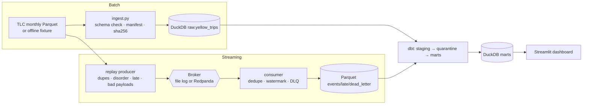
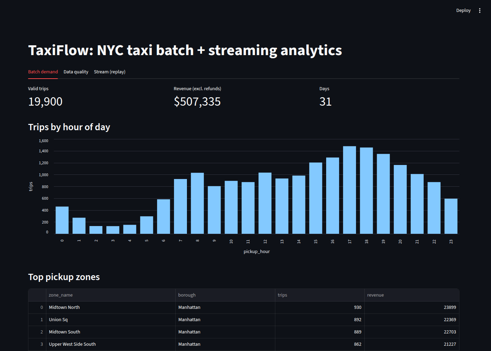
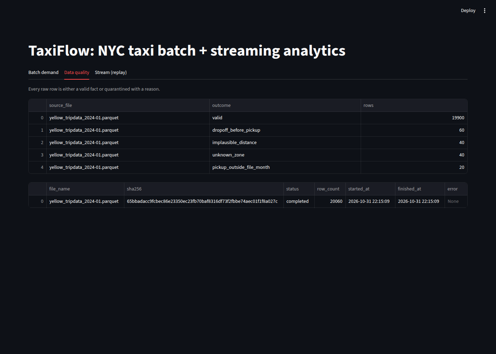
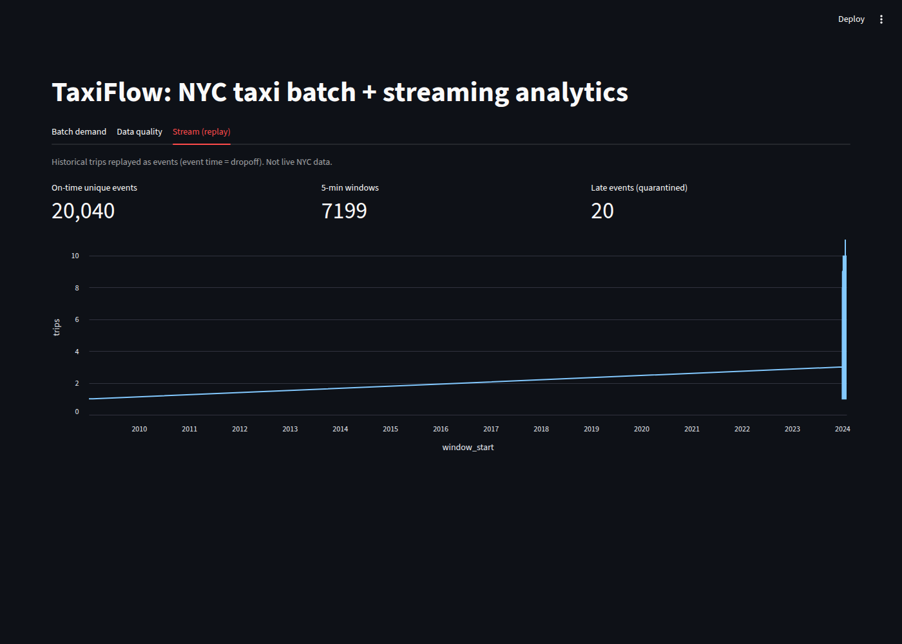

# TaxiFlow — local batch + streaming data platform

[](https://github.com/dragon28/taxiflow/actions/workflows/ci.yml)

An end-to-end data engineering project on public **NYC TLC yellow-taxi trips**, runnable on a laptop
with no cloud account. One repo, two pipelines, one warehouse:

* **Batch ELT** – monthly Parquet files → idempotent, schema-validated load into DuckDB → dbt
  staging / quarantine / star schema / marts, with data-quality tests and reconciliation.
* **Streaming** – historical trips replayed as events (event time = dropoff) through a broker →
  consumer with dedupe, event-time watermark, late-event and dead-letter handling →
  Parquet sink → dbt 5-minute windows.

> The stream is a **simulated replay of historical public data**, not live NYC telemetry.
> CI and the default demo use a **deterministic synthetic fixture** in the exact TLC schema
> (with injected data problems); real months can be downloaded with one command.

## Architecture



## Quick start

Requires [uv](https://docs.astral.sh/uv/) (it installs Python 3.12 for you).

```bash
make setup        # install dependencies
make demo         # fixture → batch load → stream replay → dbt build (all tests)
make dashboard    # http://localhost:8501
make test         # unit + integration tests
```

Real data and a real broker:

```bash
uv run taxiflow download 2024-01:2024-03 && uv run taxiflow ingest && make transform
make up && make stream BROKER=kafka   # needs Docker; Redpanda Console at :8080
```

## Dashboard preview

Screenshots of the Streamlit dashboard running on the **deterministic synthetic fixture** (TLC schema,
real zone lookup). The figures are demo output, not findings about real NYC traffic.





## Validated demo results

From `make test` and `make demo` on the fixture (also run in CI):

| Check | Result |
|---|---|
| pytest | 9 tests passed |
| `dbt build` | 39 steps succeeded (1 seed, 11 models, 27 data tests) |
| Batch | 20,060 raw rows → 19,900 valid trips + 160 quarantined |
| Stream replay | 20,432 messages → 20,040 accepted, 367 duplicate deliveries removed, 20 late, 5 malformed |
| Rerun | second `make demo` loads nothing new (idempotent) |

## Data model

| Model | Grain | Notes |
|---|---|---|
| `raw.yellow_trips` | one row of one source file | key = `(source_file, source_row)`; TLC has no trip id |
| `raw.ingest_manifest` | one source file | sha256, status, row count, error |
| `staging.stg_yellow_trips` | one raw row | typed + `dq_reason` (NULL = valid) |
| `intermediate.int_trips_quarantine` | one rejected row | reason codes, kept for inspection |
| `marts.fct_trips` | one valid trip | FK → `dim_zone`, `dim_date` |
| `marts.mart_zone_hourly_demand` | zone × date × hour | trips, revenue (refunds excluded) |
| `marts.mart_stream_windows` | 5-min event-time window | from deduplicated stream events |

## Engineering decisions

* **Idempotent batch loads.** Unchanged file (same sha256) → skipped. Changed file → its rows
  are replaced in one transaction. Row counts are reconciled against the file before commit.
* **Nothing is silently dropped.** Every raw row is either in `fct_trips` or the quarantine
  (enforced by a dbt test). Refunds/disputes are flagged, not treated as errors.
* **Identical rows are kept.** Hash-based dedupe of trips would wrongly merge real trips.
* **Delivery semantics: at-least-once + idempotent persistence.** The consumer writes
  deterministic file names (`part-<first offset>-<last offset>`) atomically, *then* commits offsets.
  With the file broker and fixed batch size, a crash replays into the same files (tested); Kafka recovery is untested; cross-restart duplicates are removed in dbt.
  This is tested with a simulated crash.
* **Event time, not processing time.** Watermark = max event time − allowed lateness (15 min).
  Older events go to `stream/late/` and are counted; malformed payloads go to `dead_letter/`.
* **Why DuckDB + Parquet sink:** zero-ops and fast locally. DuckDB allows one writer process,
  so the consumer writes Parquet and dbt reads it, avoiding lock contention.
  At scale I would swap to Postgres/Iceberg + Spark/Flink; see `docs/decisions.md`.

## Testing

* `pytest`: idempotent reruns, changed-file replacement, schema failure rollback, duplicate
  preservation, stream dedupe/late/invalid routing, crash-before-commit recovery, offset resume,
  and a full pipeline + `dbt build` integration test.
* `dbt build`: unique/not_null/relationships/accepted_values plus custom reconciliation tests.
* CI runs everything on the offline fixture (no downloads, no Docker).

## Limitations / next steps

* Docker/Redpanda path is not exercised in CI.
* TLC timestamps are local NYC time without zone; DST-ambiguous hours are not resolved.
* `fct_trips` is a full rebuild; an incremental model partitioned by source month is the next step.
* Orchestration is Make + CLI; a Dagster asset graph with monthly partitions would be a natural addition.

## License

MIT

## Repo layout

```
src/taxiflow/batch/    download + ingest
src/taxiflow/stream/   events (replay), broker (file/Kafka), consumer
src/taxiflow/sample.py deterministic fixture
dbt/                   models, seeds (official zone lookup), tests
dashboard/             Streamlit app
tests/                 pytest
docs/                  decisions and runbook
```
